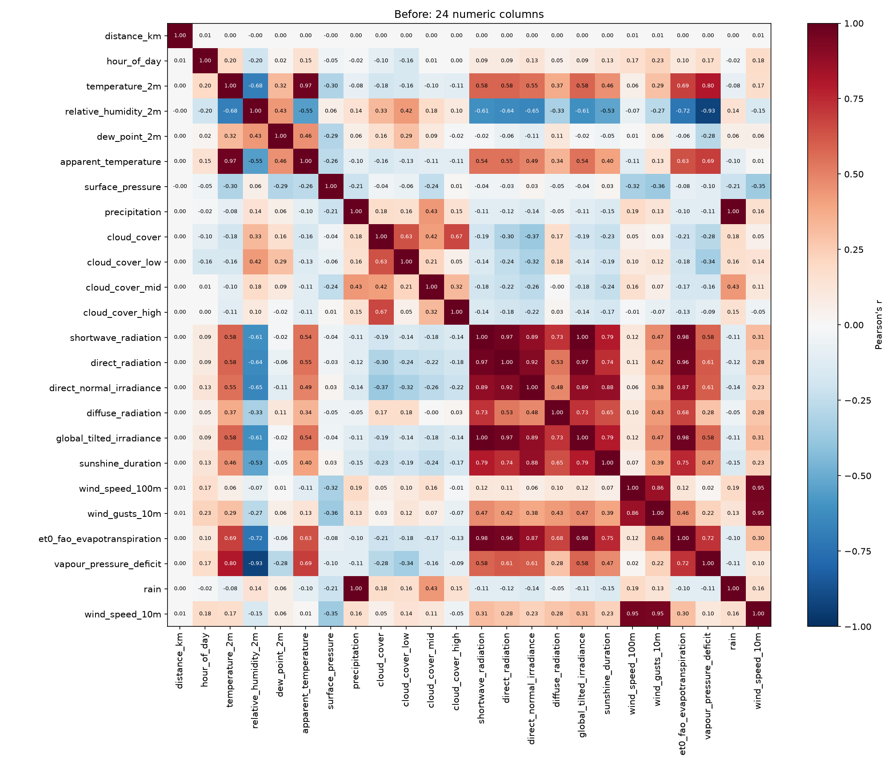
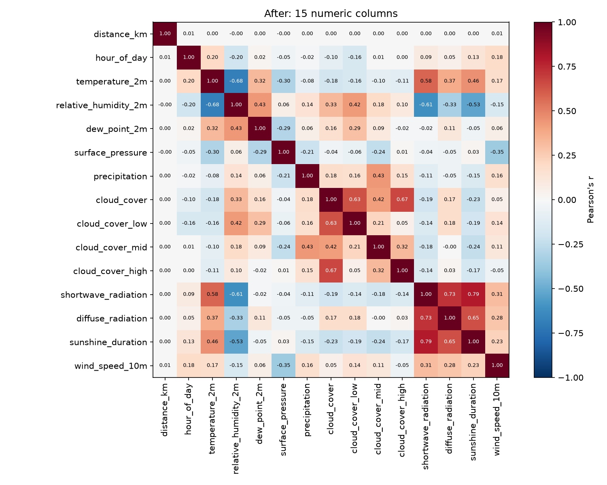
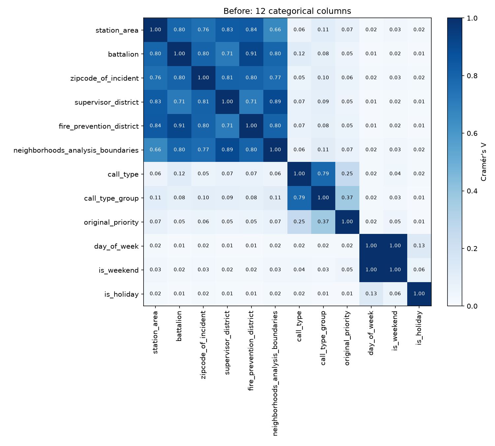
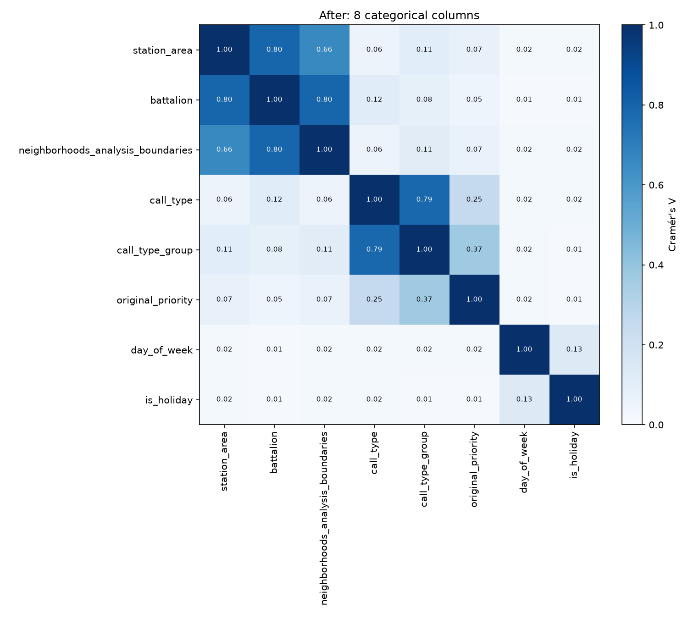
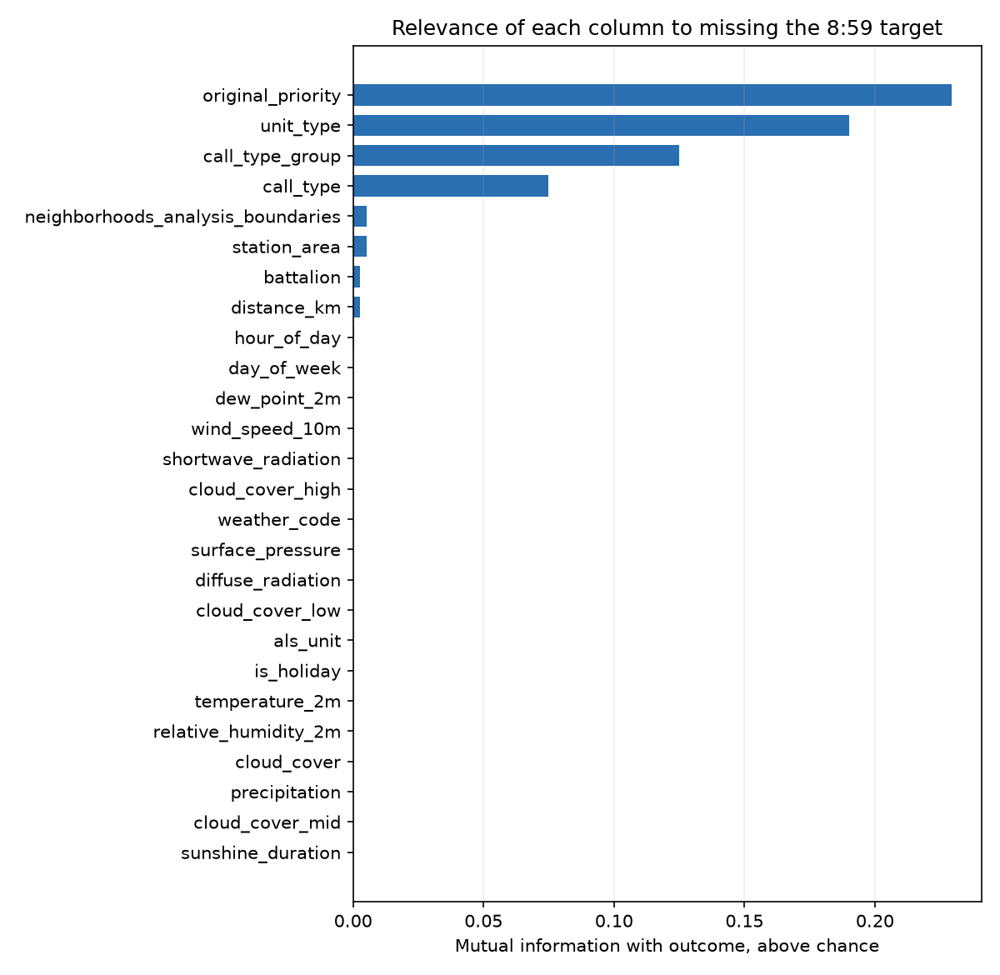
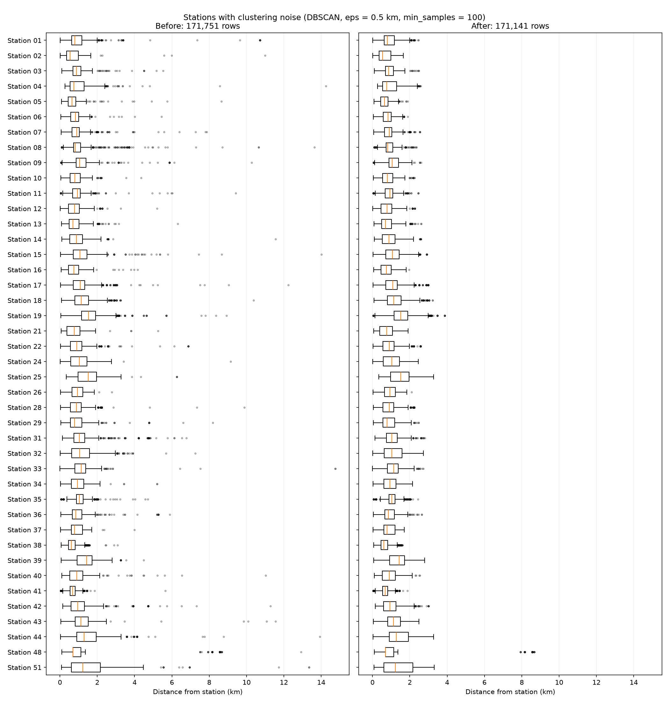
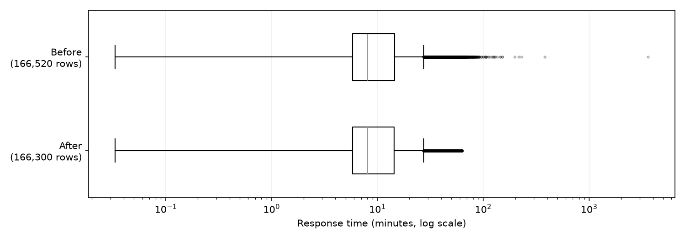
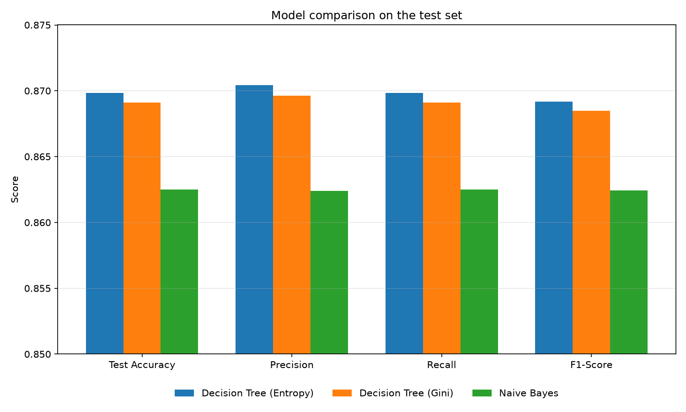

# Predicting SFFD First Response Target Achievement

## Table of Contents

- [Section 1: The Idea and Dataset](#section-1-the-idea-and-dataset)
  - [1.1 The Idea](#11-the-idea)
  - [1.2 Dataset Description](#12-dataset-description)
- [Section 2: Data Preparation](#section-2-data-preparation)
  - [2.1 Initial Dataset Review](#21-initial-dataset-review)
  - [2.2 Removing Redundant and Irrelevant Columns](#22-removing-redundant-and-irrelevant-columns)
  - [2.3 Handling Missing Values](#23-handling-missing-values)
  - [2.4 Cleaning Noisy Data](#24-cleaning-noisy-data)
  - [2.5 Prepared Dataset and Analysis](#25-prepared-dataset-and-analysis)
- [Section 3: Algorithm Description](#section-3-algorithm-description)
  - [3.1 Choosing Classification & Splitting Dataset](#31-choosing-classification--splitting-dataset)
  - [3.2 Why K-Nearest Neighbour was not used](#32-why-k-nearest-neighbour-was-not-used)
  - [3.3 Decision Tree Model](#33-decision-tree-model)
  - [3.4 Naive Bayes Model](#34-naive-bayes-model)
- [Section 4: Results and Analysis](#section-4-results-and-analysis)
  - [4.1 Model Results Comparison Summary](#41-model-results-comparison-summary)
  - [4.2 Model Analysis](#42-model-analysis)
  - [4.3 Result Analysis](#43-result-analysis)
- [Section 5: Appendices](#section-5-appendices)
  - [5.1 References](#51-references)

---

## Section 1: The Idea and Dataset

### 1.1 The Idea

Fire and EMS are judged on how quickly the first unit reaches the scene. The San Francisco Department (SFFD) uses a target of 8 minutes 59 seconds or 539 seconds from the call being received to the first unit arriving on scene. Missing this target can matter in time-critical incidents.

Our project predicts whether a call will meet this target. We frame it as a binary classification problem. Given what we know from our collected data such as unit type, priority, distance etc, will the first arriving unit reach the scene within 8:59 (1 = met, 0 = missed). This mark was not decided by us instead it was grabbed from here. A model that predicts this could help dispatch plan and identify which kinds of calls and areas are at risk of slow response.

### 1.2 Dataset Description

For our dataset we combined two different sources that we scraped between these dates, `start_date='2025-09-28'`, `end_date='2026-09-29'`:

- **SFFD Fire & EMS Calls:** one row per unit responding to a call. This means one incident can have multiple rows. It records call details and a timeline of each response (received, dispatch, response, on-scene, etc).
- **Open-Meteo Weather:** hourly historical weather for San Francisco, including temperature, humidity, precipitation and more.

We joined the weather to the call data on the hour the call was received. The `received_dttm` timestamp was rounded to the nearest hour to match the weather time column. We also added a road distance (km) between the responding station and the incident, computed with OSRM (Open Source Routing Machine), and derived flags such as `hour`, `day`, `is_weekend`, `is_holiday`.

The merged raw dataset has 366,354 rows and 75 columns. Because the label was not available for every row, the raw level distribution was 44.0% success, 34.3% missed and 21.7% unlabeled.

#### Calculating the Outcome

The outcome column is not recorded by SFFD, so we calculated it. Response time is the on-scene time minus the received time (from when the 911 dispatch receives the emergency call), in seconds. The outcome is 1 if the response time is under 539 s (8:59) and 0 otherwise.

A call with no on-scene timestamp has no response time, so it gets no outcome. These are the 21.7% unlabeled rows above. We treat this as completing the dataset rather than cleaning it. The unlabeled rows are dropped later (Section 2), because a guessed label would teach the model something false. The calculation also labels any zero or negative response time as met. These times are impossible, so they are removed during noise removal (Section 2).

#### Calculating distance from coordinates

Each incident in the SFFD data has a case location field holding a point, which we split into longitude and latitude. We stored the coordinates of each fire station in a lookup table and matched every incident to its station through `station_area`. We then used OSRM to calculate the driving distance in km along roads from station to the incident. Requests were sent in batches of 50 to prevent API throttling and the results were cached, so each station-to-incident trip was only calculated once and the longitude and latitude were rounded down to roughly an 11m area so similar incidents could be looked up in cache. This gives the numeric column `distance_km`, which is how far the first unit travelled. Incidents with no `case_location`, or where OSRM could not find a route, have no distance. These rows are dropped in Section 2.

- Meteo: https://archive-api.open-meteo.com/v1/archive
- SFFD: https://data.sf.gov/resource/nuek-vuh3.json

---

## Section 2: Data Preparation

As part of our submission for step 2 of the assignment, we prepared our data using Data Cleaning, particularly due to the dataset being scraped and requiring this preparation anyway before any model training could be completed.

### 2.1 Initial Dataset Review

The first step we took before looking at any algorithms was to analyse data we had collected. We used the documentation for both datasets [1] [2] and looked at the descriptions of each column and the type of value they contain to get a full understanding of the nature of the data we were working with. From this initial analysis, we noticed columns which were completely redundant to the classification for a variety of reasons.

This section covers Data Cleaning as a process, combining our knowledge of the data with the process of discrepancy detection to prepare the dataset.

#### 2.1.1 Clearly Redundant Columns

**Identifiers**

The first thing we noticed were a number of ids that would have no relevance to outcome. This included: `call_number`, `unit_id`, `incident_number` and `rowid`, dropping 4 columns. To make sure that these columns were unique, we used pandas to create a table of each entry of each column, and the number of times it has occurred, along with a percentage of its occurrence to the rest of the column entries. For `call_number`, `unit_id` and `rowid` (the concatenation of `call_number` and `unit_id`) the occurrence data below shoes ids act as random identifiers and were removed.

| call_number | count | % |
| ----------- | ----- | - |
| 261801805 | 61 | 0.02 |
| 253460284 | 53 | 0.01 |
| 253112761 | 43 | 0.01 |
| 252880356 | 40 | 0.01 |
| 262180197 | 34 | 0.01 |
| 261952216 | 33 | 0.01 |
| 261582835 | 32 | 0.01 |
| 262450414 | 31 | 0.01 |
| 260242917 | 31 | 0.01 |
| 262001305 | 29 | 0.01 |

*Fig 2.1.1 - Occurrence data of call_number column*

| unit_id | count | % |
| ------- | ----- | - |
| E03 | 9958 | 2.72 |
| E01 | 9056 | 2.47 |
| T03 | 6371 | 1.74 |
| E36 | 5956 | 1.63 |
| E07 | 5435 | 1.48 |
| B02 | 5111 | 1.40 |
| RC1 | 4996 | 1.36 |
| E06 | 4474 | 1.22 |
| E41 | 4201 | 1.15 |
| E05 | 4037 | 1.10 |

*Fig 2.1.2 - Occurrence data of unit_id column*

We finally looked at `incident_number`, which again, for the same reason as `call_number`, we looked to remove it as it was clearly redundant. However, at this moment of data preparation, we left the column in the dataset. The reason for this decision is explained in more detail later in Section 2.1.2.

| incident_number | count | % |
| --------------- | ----- | - |
| 26091643 | 61 | 0.02 |
| 25176304 | 53 | 0.01 |
| 25159114 | 43 | 0.01 |
| 25146981 | 40 | 0.01 |
| 26110413 | 34 | 0.01 |
| 26099186 | 33 | 0.01 |
| 26080874 | 32 | 0.01 |
| 26124049 | 31 | 0.01 |
| 26012418 | 31 | 0.01 |
| 26101560 | 29 | 0.01 |

*Fig 2.1.3 - Occurrence data of incident_number column*

**Information Known After Response**

The next clearly redundant columns to predicting first response time achievement were columns with information that could only be known after the first response had arrived or can change throughout the incident being resolved. These included timestamps from after the response, such as `hospital_dttm`, and response data such as `final_priority`. This resulted in 7 columns being dropped.

**Less Accurate Location Details**

We noticed various columns which represented locations associated with an incident, with the most important one being the exact co-ordinates of the incident, and the station area (where units would be dispatched from) so that we can calculate the distance from unit to incident (explained more in Section 1.2), which would be valuable in being able to predict response time achievement. This meant that we were able to remove the other location details which wouldn't be able to provide as much information, such as address, with too many unique values, dropping 3 more columns.

| address (7619 unique) | count | % |
| --------------------- | ----- | - |
| EDDY ST/MASON ST | 2129 | 0.58 |
| EDDY ST/LEAVENWORTH ST | 2063 | 0.56 |
| EDDY ST/TAYLOR ST | 1891 | 0.52 |
| MINNA ST/RUSS ST | 1856 | 0.51 |
| ELLIS ST/LEAVENWORTH ST | 1800 | 0.49 |
| 06TH ST/MISSION ST | 1680 | 0.46 |
| ELLIS ST/JONES ST | 1634 | 0.45 |
| 06TH ST/STEVENSON ST | 1551 | 0.42 |
| 16TH ST/SOUTH VAN NESS AVE | 1521 | 0.42 |
| JONES ST/TURK ST | 1505 | 0.41 |

*Fig 2.1.4 - Occurrence data for address column*

| box (2006 unique) | count | % |
| ----------------- | ----- | - |
| 2251 | 5758 | 1.57 |
| 1453 | 3796 | 1.04 |
| 1545 | 3683 | 1.01 |
| 1461 | 3530 | 0.96 |
| 2318 | 3138 | 0.86 |
| 2252 | 3121 | 0.85 |
| 5236 | 3091 | 0.84 |
| 1456 | 2808 | 0.77 |
| 1546 | 2627 | 0.72 |
| 2248 | 2609 | 0.71 |

*Fig 2.1.5 - Occurrence data for box column*

We decided to keep `zipcode_of_incident` as there were only 54 unique values, meaning it would be easier to be able to get a correlation between a particular zipcode and a response time.

| zipcode_of_incident (54 unique) | count | % |
| ------------------------------- | ----- | - |
| 94103.0 | 40235 | 10.98 |
| 94102.0 | 32204 | 8.79 |
| 94109.0 | 27295 | 7.45 |
| 94110.0 | 21623 | 5.90 |
| 94103 | 15047 | 4.11 |
| 94124.0 | 13027 | 3.56 |
| 94102 | 12033 | 3.28 |
| 94112.0 | 11229 | 3.07 |
| 94109 | 10250 | 2.80 |
| 94115.0 | 10218 | 2.79 |

*Fig 2.1.6 - Occurrence data for zipcode_of_incident column*

**Irrelevant Timestamps**

Since we were only scraping data over the course of a year, there wouldn't be enough data for a model to be able to use things like the month of the year to help make it's prediction. Therefore, the only time related data we required was to calculate the response time to an incident (described in Section 1.2). This meant that we could remove all other irrelevant timestamps, which included dropping a further 7 timestamp columns across SFFD and meteorological data.

**Irrelevant Weather Data**

From our initial analysis, we also noticed several weather columns which would have no effect on incident responses, as they measured soil data, such as columns on soil temperature and moisture. Therefore, we removed the following columns such as `soil_temperature_0_to_7cm`, removing a total of 8 columns.

Similarly to the SFFD data, we used pandas to create a table which counted the occurrence of entries for each column of weather data, and the percentage relevant to all other entries in that column. From this we noticed that we could remove `snowfall`, as only 40 total entries contained an entry above 0 out of 366,314, which would be far too little data for a model to be able to use to help classify the response time achievement.

| snowfall | count | % |
| -------- | ----- | - |
| 0.00 | 366314 | 99.99 |
| 0.07 | 40 | 0.01 |

*Fig 2.1.7 - Occurrence data for snowfall column*

**More Non-First Responder Columns**

Then, the final thing that we noticed from our initial analysis of the dataset, was the `unit_sequence_in_call_dispatch` column. This was what initially triggered our investigation into the dataset containing multiple responses to one incident, which we saw to be true (See Fig 2.1.8).

| zipcode_of_incident | battalion | box | priority | final_priority | als_unit | number_of_alarms | unit_sequence_in_call_dispatch | fire_prevention_district | supervisor_district | neighborhoods_analysis_boundaries |
|---|---|---|---|---|---|---|---|---|---|---|
| 94102 | B04 | 1544 | 2 | 2 | True | 1 | 1 | 2 | 5 | Tenderloin |
| 94117 | B05 | 5145 | 3 | 3 | True | 1 | 2 | 5 | 8 | Inner Sunset |
| 94117 | B05 | 5145 | 3 | 3 | True | 1 | 1 | 5 | 8 | Inner Sunset |

*Fig 2.1.8 - 2 rows of dataset (bottom) showing 2 units dispatched to same incident*

Therefore, we removed the `unit_sequence_in_call_dispatch` column as we would only be taking one response to each incident.

#### 2.1.2 First Response Only

The next step of our data preparation was to remove all rows containing non-first responses to an incident, as the target of our classification is to classify whether an incident will be responded to within the target time of 8 minutes and 59 seconds, so we only need the first response.

So we sorted incidents on the `on_scene_dttm`, grouped on the `incident_number`, so we had all incidents sorted with the earliest `on_scene_dttm` on top of the group. Then, all we had to do was drop all duplicates of `incident_number`, and only keep the first entry of it. This left us with only the rows that were the first response to their respective incident.

This basically cut the length of our dataset in half, to 183,475 rows, dropping 182,879 rows, which while a drastic drop, still left us with plenty of data to train an algorithm on, but now all rows would be relevant to the classification. After this step, we were able to remove the `incident_number` as it now only acted as an identifier (see Section 2.1.1) and the `on_scene_dttm` and `received_dttm` columns as well, as they were already covered by the `response_time` column, and the `day_of_week` and `hour_of_day` columns.

### 2.2 Removing Redundant and Irrelevant Columns

Before we started the data cleaning process, we wanted to make sure we weren't going to be cleaning columns that were going to be dropped afterwards anyway.

#### 2.2.1 Numerical Column Redundancy

The overall goal was to remove numeric columns that had a strong correlation to another column, where only one of the two correlated columns were needed. To do this for the numerical columns, we used Pearson's Product [3] to calculate the correlation coefficient (|r|), and for any two columns with a coefficient r >= 0.8, we kept only one column. We created a heatmap for each numeric column to better understand the correlations, and choose which high correlation columns to keep and which to drop.

**Before High Correlations Removed**

*Fig 2.2.1 - Correlation Heatmap created using matplotlib showing the correlation (r) of each column on every other column before removing high correlations*

**After High Correlations Removed**

*Fig 2.2.2 - Correlation Heatmap created using matplotlib showing the correlation (r) of each column on every other column after removing high correlations*

We dropped `wind_speed_100m`, `wind_gusts_10m`, `wind_gusts_100m` as they all had a high or direct correlation to `wind_speed_10m`. We dropped `global_tilted_irradiance`, `et0_face_evaporation`, `direct_radiation` and `direct_normal_irradiance` as they all had high or direct correlation to `shortwave_radiation`. We dropped `rain` as it had a direct correlation to `precipitation`. Finally, we dropped `vapour_pressure_deficit` as it had just high enough of a correlation to `temperature_2m`. In total, we dropped 9 numeric columns, all related to weather data.

#### 2.2.2 Categorical Column Redundancy

To remove redundant, high correlating categorical columns, we used Cramer's V Correlation [4] to get a correlation coefficient for categorical data, based on the Chi-Square Test. We used Cramer's V as the Chi-Square Test doesn't give a value between 0-1 to act as a correlation coefficient, and we used it over the Phi Coefficient as the Phi Coefficient is specifically for 2x2 tables.

We then removed high correlation columns in the same way as numerical columns and used a heatmap to help understand which correlating columns to drop.

**Before High Correlations Removed**

*Fig 2.2.3 - Correlation Heatmap created using matplotlib showing the correlation (r) of each column on every other column before removing high correlations*

**After High Correlations Removed**

*Fig 2.2.4 - Correlation Heatmap created using matplotlib showing the correlation (r) of each column on every other column after removing high correlations*

We dropped `is_weekend` as it had a direct correlation to `day_of_week`.

We then had to navigate the high correlations between many of the location-based columns which was quite a challenging process to get right. We started by removing the columns which had a clear high correlation: `supervisor_district` and `fire_prevention_district`. We then decided to remove `zipcode_of_incident` and kept `neighbourhoods_analysis_boundaries` as they both covered the general area of the incident quite similarly, however `zipcode_of_incident` had a higher correlation to `battalion`.

We then couldn't decide on which of `battalion` and `station_area` to confidently drop as they both seemed to cover equally relevant and different information, so we decided to see if the correlation to the outcome of the remaining columns would maybe solve that issue for us (See section 2.2.3). In total we dropped 4 high correlation categorical columns.

#### 2.2.3 Correlation to Outcome

We then used mutual information, which measures how strongly two variables depend on each other [7], to compare how much each column contributes to predicting the outcome/classification.

We used sklearn to calculate the mutual information score for each column against the outcome column and removed all columns that the outcome has no dependency on.

*Fig 2.2.5 - Bar chart showing mutual information for each column with the outcome (i.e. if the response time is met).*

The columns `original_priority`, `unit_type`, `call_type_group`, `call_type`, `neighborhoods_analysis_boundaries`, `station_area`, `battalion`, `distance_km`, `incident_response_time` (left out of mutual information calculation as it is used to calculate the outcome so it would be a direct dependency) and `outcome` are the 10 we were left with following that process. Leaving us with a total of 183,475 rows.

### 2.3 Handling Missing Values

To handle missing values we looked at the text book to see the correct operations to handle missing data. There were 6 different methods that we could apply to handle missing data in each column. One of these methods was fill in the missing value manually, this was not a realistic option for any column as it was too large of a dataset and we may not be able to find the correct data to fill it in. For our outcome column we went with method 1 ignore the tuple as it is the label, a guessed value for this column would mislead the model into false training.

We used method 1 for original priority, station area, neighborhood and distance. Original priority is our strongest predictor, as the strongest predictor it would be the primary split in our classification model. If we were to guess it it would introduce severe label noise at the top of the decision hierarchy in the tree. Method 1 was a safe option as we would still have more than enough rows to train after removal and it did not affect the data itself. For the other three there was roughly 100 rows in total missing values so it was not worth the cost of calculating the most probable value or using the central tendency.

Method 3: Targeted global constant replacement was used for `call_type_group`. After checking the data we noticed that the missing values for `call_type_group` were because of the column `call_type` had values labelled "Other" that were not assigned a group in the first place. We decided to fill these null entries with the global constant "unknown" rather than guessing a category.

### 2.4 Cleaning Noisy Data

Noisy data is a random error or variance in a measured variable [11]. Noisy data such as outliers can inaccurately skew your dataset and therefore it is necessary to eliminate it. Noisy data can only really occur in numerical data columns, therefore we only applied these methods to `distance_km` and `incident_response_time`.

#### 2.4.1 distance_km

To clean the `distance_km` we initially looked to the textbook and began trying the techniques specified there. We first looked at binning, smoothing small "bins" of data to the mean or median of the bin. We saw potential issues with this, as binning "smooths" the data, which could result in the wrong predictions being formatted as the distances weren't a true reflection of the data.

We looked to linear regression next, but in the same way, we couldn't justify smoothing the data and creating misleading data.

This left us with the only solution being outlier analysis, removing the outliers rather than smoothing them to match the average of the data. The textbook details of outliers may be detected by clustering, where values outside of clusters may be considered outliers. We looked at k-means clustering to do this, however we noticed that we couldn't figure out a k value to input for the number of clusters, to cluster the data accurately. We continued our research and found Density Based Clustering (DBSCAN) [8], where the clusters are created dynamically if there are a certain number of values nearby which create a core point, and then any neighboring values within a certain range are considered a part of that cluster, any values outside any cluster is an outlier. This is the method we used to clean the noisy data for `distance_km`. The text book also mentioned data visualization techniques, such as boxplots and scatter plots to identify outliers, therefore we used boxplots to make sure out DBSCAN removals made sense. We grouped them by station as this would be the starting point of each dispatch.

*Fig 2.4.1 - Section of Boxplot showing clusters and before and after of removal of outliers*

We noticed that for station 48, there was a cluster very far from the IQR box. Before writing this off as an issue with our program executing the DBSCAN, we used Data Cleaning as a Process first to identify if this truly was a discrepancy. We went to Google Maps and put in the station number and San Francisco. We saw the station was located on treasure island, which is connected by bridge to the mainland of San Francisco. We used Google Maps to measure this distance of bridge and saw it came to ~5.1 miles (which is 8.2km), which is right around where the cluster for station 48 was on the boxplot, so we left it in the dataset and took no further action.

This removed 610 rows (171,751 -> 171,141) and had the following effect on the data:

|                        | BEFORE   | AFTER    |
|------------------------|----------|----------|
| **MEAN**               | 0.946 km | 0.933 km |
| **MEDIAN**             | 0.868 km | 0.867 km |
| **STANDARD DEVIATION** | 0.559 km | 0.5 km   |
| **Q1**                 | 0.626 km | 0.632 km |
| **Q3**                 | 1.185 km | 1.181 km |
| **SKEW**               | 5.01     | 3.67     |

*Fig 2.4.3 - Table showing data on distance_km.*

This table shows that we were able to remove the distance outliers, reducing the skew of the data, without largely affecting the overall nature of the data itself, showing a successful handling of the noisy data.

#### 2.4.2 incident_response_time

We conducted the same steps for cleaning `incident_response_time` as for `distance_km`. We first looked at binning to see if we could smooth the data, but we noticed that any data smoothing methods wouldn't be viable for outliers of response time, as the smoothing process could push neighboring times to the outcome time, 8 mins 59 secs, over or under the threshold, swaying the dataset. This struck out binning and linear regression as cleaning methods for noisy response times.

This put us back to looking at outlier analysis, and thus, clustering. In the same way, k-means clustering didn't seem like an appropriate method as we couldn't see how to come up with an accurate k value for the clusters. So, we tried looking at DBSCAN again.

Our first step in the process this time was using Data Cleaning as a Process to look out for discrepancies in the data again, and first we removed all times which were not possible (i.e. there were less than or equal to 0) - dropping 4,621 rows.

We then clustered using the same method as before for DBSCAN, removing any entries which fell outside the clusters, removing a further 220 rows. This data shows that we were successfully able to remove the noisy data, dropping the skew massively, without changing the nature of the dataset for response times.

*Fig 2.4.4 - Boxplot showing clusters and before and after of removal of outliers*

This dropped a total of 4,841 rows (171,141 -> 166,300) and had the following effect on the data:

|                        | BEFORE | AFTER |
|------------------------|--------|-------|
| **MEAN**               | 655s   | 667s  |
| **MEDIAN**             | 474s   | 483s  |
| **STANDARD DEVIATION** | 726s   | 472s  |
| **Q1**                 | 339s   | 348s  |
| **Q3**                 | 853s   | 866s  |
| **SKEW**               | 154.03 | 1.90  |

*Fig 2.4.5 - Table showing data on incident_response_time.*

### 2.5 Prepared Dataset and Analysis

In conclusion, the data preparation of our dataset resulted in the following, 166,300 rows, 10 columns (with 0 missing values), 56.1% / 43.9% split in outcome (Met Target / Missed). This left us with a reasonably balanced ratio without requiring any synthetic re-sampling.

---

## Section 3: Algorithm Description

### 3.1 Choosing Classification & Splitting Dataset

Predicting whether an SFFD response meets the target is framed as a binary classification problem in that our outcome label can be 1 or 0, where 1 means the target was met and 0 means missed. Once we had our cleaned dataset, which ended up as 166,300 rows and 8 predictors, it was split into 80% training data and 20% unseen test data. We chose random sub sampling over cross validation because our dataset was so large that there would be very little variance in the subsets. We also used `train_test_split(... random_state=42)` in sklearn's library as it ensures that all of our models will be evaluated on the same 80/20 split.

### 3.2 Why K-Nearest Neighbour was not used

Although k-nearest neighbour (k-NN) is a common algorithm we believed that it was not suitable for our dataset for a few reasons:

- In the notes it specifies that k-NN is generally used when attributes are continuous because it relies on geometric distance formulas to measure how close two instances are in n-space. In our dataset, 7 out of 8 predictors are unordered nominal categories alongside one continuous attribute which is `distance_km`. Converting those 7 categorical fields into 147 binary columns via One-Hot Encoding creates a 148-dimensional space where arbitrary categorical mismatches add 1's to the distance distorting the operational similarity between emergency calls.
- Another reason is that k-NN calculations are skewed when attributes use different scales unless we use the Min-Max Normalisation and domain-specific attribute weightings are made. Along with this if we have an unseen test where the `distance_km` value is greater or less than the min and max we used the normalisation range has to be changed to account for the new boundary. This issue does not apply for either decision trees or naive bayes.
- Finally unlike decision trees that compress the training data into if-then classification rules during training k-NN performs no model compression and must compute distances across all ~133000 trainings rows in 148 dimensions for every test call which is ~33000 which ends up being around 4 billion distance calculations during the run.

### 3.3 Decision Tree Model

We decided to select Top-Down Induction of Decision Trees (TDIDT) as our primary classification model. TDIDT recursively partitions the training tuples into subsets by selecting an attribute to split at each node until we reach a terminating condition. It produces something like a flow chart full of if-then rules where it leads you down a path. In terms of making/designing our decision tree and preventing overfitting, three key implementation steps were applied:

- First we tried two different splitting measures against each other. The basic TDIDT algorithm does not specify how to choose the best attribute at each node so we tried both Information Gain (Entropy) and Gini Index:
  - Information gain computes the expected information needed to classify a tuple in partition D using the formula on pg 26 (the top right slide) and selects the attribute A.
  - Gini index measures node impurity using the formula on pg 33 (top right slide) and creates binary partitions that will maximise the impurity reduction.
- Then we had to mix discrete and continuous data. We converted the seven nominal categorical predictors into 147 binary indicators using One-Hot Encoding and `distance_km` was left alone leaving us with 148 features. Putting all predictors into a single numeric table allows the TDIDT to test every attribute consistently using binary splits checking whether a category is present or absent (0 or 1) on the encoded columns, and finding optimal distance thresholds on `distance_km`.
- As highlighted in the notes unconstrained classifiers have a tendency to overfit by memorising anomalies in the training data that do not generalise unseen test samples. We included pre-pruning constraints which were that the tree had a max depth of 10 and that each leaf node needed to be supported by at least 50 historical calls.

### 3.4 Naive Bayes Model

A Naive Bayes classifier was also implemented as a probabilistic comparison model. Naive Bayes estimates the posterior score for each mutually exclusive class by multiplying the prior probability by the class conditional probabilities of each attribute under the assumption that each condition is independent. In general Naive Bayes faces two practical issues that we addressed in our setup:

- Standard frequency based Naive Bayes requires all attributes to be categorical however our dataset includes the continuous data, `distance_km`. To model the other categorical data with `distance_km` the categorical data was integer-encoded and modeled with a Categorical Naive Bayes component while distance was modeled using a Gaussian Naive Bayes component.
- Estimating probabilities using simple frequency counts does not give a good estimate if a certain category combination rarely appears in the training data. In the case where a combination never appears for a class, its probability becomes zero which forces the entire multiplied score for that class to become 0 as well. To prevent this we added 1 as a small baseline count so it was never equal to zero.
- Since we had to use two separate Naive Bayes models each unseen test call gets a probability from both. We multiply those two probabilities together and divide once by the overall class probability, then predict whichever class has the higher final score.

---

## Section 4: Results and Analysis

### 4.1 Model Results Comparison Summary

All three models were evaluated on the same unseen test set. We evaluated each model on 4 different metrics:

- **Test Accuracy:** The proportion of all tests that were classified correctly
- **Precision:** Of the predictions the algorithm predicted would meet the target, the proportion that actually did.
- **Recall:** The proportion of predictions that did meet the target that the algorithm labeled successfully.
- **F1-Score:** The harmonic mean of precision and recall.

The table below summarises their classification scores, with further info given in section 4.

|                   | DECISION TREE (ENTROPY) | DECISION TREE (GINI) | NAIVE BAYES         |
|-------------------|-------------------------|----------------------|---------------------|
| **TEST ACCURACY** | 0.8698436560432953      | 0.8691220685508118   | 0.86250751653638    |
| **PRECISION**     | 0.87042446846656389     | 0.8696215696583161   | 0.86239442642012889 |
| **RECALL**        | 0.86984365604329525     | 0.8691220685508118   | 0.86250751653638005 |
| **F1-SCORE**      | 0.86916108745376548     | 0.86846309617171812  | 0.86243701539731916 |

*Fig 4.1.1 - A table showing model results including accuracy, precision, recall, f1-score*

| Model | Test Accuracy | Training Accuracy | Precision (0/1/Macro) | Recall (0/1/Macro) | F1-Score (0/1/Macro) |
|---|---|---|---|---|---|
| Decision Tree (Entropy) | 86.98% | 87.06% | 0.88/0.86/0.87 | 0.81/0.91/0.86 | 0.85/0.89/0.87 |
| Decision Tree (Gini) | 86.91% | 87.04% | 0.88/0.86/0.87 | 0.81/0.91/0.86 | 0.85/0.89/0.87 |
| Naive Bayes | 86.25% | 86.12% | 0.85/0.87/0.86 | 0.84/0.88/0.86 | 0.84/0.88/0.86 |

*Fig 4.1.2 - Another table showing more specific model results, including breakdown by outcome success and training accuracy*

### 4.2 Model Analysis

The first thing we noticed from the classification scores of our implemented models was that none of the implementations accuracy was around the data split of successful achievements of target time response at 56.1%. This shows that all model implementations were not just guessing the outcome as this would've aligned with an accuracy closer to the successful response split.

Then we compared classification scores across the 3 models in the image below.

*Fig 4.2.1 - Model Comparison Bar Chart*

From this figure and from looking at our classification score table, the Decision Tree using Entropy is the clear most accurate model across all scores, but not by a large amount between the other two models, particularly the Gini Decision Tree.

The main reason for the Entropy Decision Tree being slightly more accurate is due to it's higher computational complexity, making use of logarithms [12]. This results in the Entropy version having a longer training time, but that slightly more accurate result that we see in Fig 4.2.1.

The Naive Bayes algorithm was the clear "loser" in terms of accuracy results. We saw the reason for this being how bayes presumes each attribute is independent from one another, when really, from what we saw in section 2.2.3 (figure 2.2.5) there is indeed not only a correlation between the attributes, but quite a high correlation with some, resulting in a lower accuracy compared to the decision tree methods.

We then looked to understand why the three models returned such similar scores. We saw the main reason behind this being the high correlation between the `original_priority` attribute and the outcome. This results in the model algorithms making the same decisions based on this attribute across the models. This can be seen particularly by the feature importance of the different models below being so similar (except for Naive Bayes which would look more like figure 2.2.5).

In hindsight to this analysis, we would have used some form of class balancing strategy [24] to stop this from happening, such as, Random Oversampling, Random Undersampling, Oversampling with SMOTE, Oversampling with ADASYN, Undersampling with Tomek Link. Overall, from our model analysis in this section, we made the clear decision to go with the most accurate algorithm across all metrics, the Entropy Decision Tree as our Classification model.

### 4.3 Result Analysis

From our analysis of the results of our chosen algorithm/model, we found the following insights:

- The model predicted 59.4% of responses met the target time.
- The model predicted 40.6% of responses did not meet the target time.
- 4.85% of classifications were False Negatives.
- 8.15% of classifications were False Positives.
- 51.2% of classifications were True Positives.
- 35.7% of classifications were True Negatives.

These insights can be seen in the Confusion Matrix of the model below:

| True label \ Predicted label | Missed (0) | Met Target (1) |
|---|---|---|
| **Missed (0)** | 11885 | 2713 |
| **Met Target (1)** | 1616 | 17046 |

*Fig 4.3.1 - Confusion Matrix for Decision Tree Entropy*

The model's results were similar with the split of the dataset. One of the core insights we got on the model's results was the lower False Negative rate compared to False Positive. When dealing with medical and emergency data like this, the affects of a False Negative tend to be far more drastic than a False Positive, it's better to be cautious, and our model achieves this. If this classification model were to be used, for example, to indicate which roads, units or station areas need more resources or better response facilities and tools, a False Negative could mean these aren't met when they need to be, which could be every dangerous, compared to a False Positive, where the correct measures are taken when unnecessary.

Overall, the accuracy of the model is high across all measurements meaning the model isn't falling behind in areas such as recall or precision, indicating a well trained model. From figure 4.1.1 we can see only a very small drop in accuracy from training to testing, indicating the model wasn't subject to overfitting, which is a common issue which occurs in decision tree algorithms, where the model learns the training data too well and struggles with data it has not seen. This shows that we removed noise and unneeded columns well in the Data Preparation steps, as this is a common reason for overfitting [25].

In reflection, while we are disappointed that the data may have correlated too much towards the outcome we were looking to predict and made our accuracy scores similar across the models we tried, we have learned a lot as to why this happened and how we could navigate future issues in this area. Otherwise, we are more confident and knowledgeable in the area, and are happy our mistakes and solutions were able to create a model that can predict the Response Target Time Achievement of SFFD Fire and EMS services.

---

## Section 5: Appendices

### 5.1 References

1. "Fire Department Calls for Service," data.sf.gov. [Online]. Available: https://data.sf.gov/Public-Safety/Fire-Department-Calls-For-Service-2016-/kikm-y2iv/about_data
2. "Historical Weather API," Open Meteo. [Online]. Available: https://open-meteo.com/en/docs/historical-weather-api
3. M. Saeed, "Calculating Pearson Correlation Coefficient in Python With Numpy," Stack Abuse. [Online]. Available: https://stackabuse.com/calculating-pearson-correlation-coefficient-in-python-with-numpy/
4. J. Hanif Watson, "Contingency Tables, Chi-Squared and Cramer's V," Towards Data Science. [Online]. Available: https://towardsdatascience.com/contingency-tables-chi-squared-and-cramers-v-ada4f93ec3fd/
5. A. Knowles, "Understanding Chi-square, Cramer's V, and Phi Coefficient," Quizlet. [Online]. Available: https://quizlet.com/study-guides/understanding-chi-square-cramer-s-v-and-phi-coefficient-be97a3ed-2b9f-4fba-bc3a-68a84e0d753a
6. M. Singh, "Understanding Categorical Correlations With Chi-Square Test and Cramer's V," Medium. [Online]. Available: https://medium.com/@manindersingh120996/understanding-categorical-correlations-with-chi-square-test-and-cramers-v-a54fe153b1d6
7. GeeksforGeeks, "Information Gain and Mutual Information for Machine Learning," GeeksforGeeks. [Online]. Available: https://www.geeksforgeeks.org/machine-learning/information-gain-and-mutual-information-for-machine-learning/
8. GeeksforGeeks, "DBSCAN Clustering in ML Density Based Clustering," GeeksforGeeks. [Online]. Available: https://www.geeksforgeeks.org/machine-learning/dbscan-clustering-in-ml-density-based-clustering/
9. A. Shafi, "Sklearn Random Forest Classifiers in Python Tutorial," www.datacamp.com. [Online]. Available: https://www.datacamp.com/tutorial/random-forests-classifier-python
10. "Validation Accuracy Vs Testing Accuracy," Cross Validated. [Online]. Available: https://stats.stackexchange.com/questions/401696/validation-accuracy-vs-testing-accuracy
11. J. Han and M. Kamber, *Data Mining: Concepts and Techniques*, 3rd ed. Haryana, India; Burlington, MA: Elsevier, 2018.
12. P. Aznar, "Decision Trees: Gini Vs Entropy ⋆ Quantdare," Quantdare. [Online]. Available: https://quantdare.com/decision-trees-gini-vs-entropy/
13. Scikit-learn, "1.9. Naive Bayes — Scikit-Learn 0.21.3 Documentation," Scikit-learn.org. Accessed: Nov. 15, 2026. [Online]. Available: https://scikit-learn.org/stable/modules/naive_bayes.html
14. "Sklearn.Preprocessing.OrdinalEncoder," scikit-learn. Accessed: Nov. 15, 2026. [Online]. Available: https://scikit-learn.org/stable/modules/generated/sklearn.preprocessing.OrdinalEncoder.html
15. "Sklearn.Naive_Bayes.CategoricalNB," scikit-learn. Accessed: Nov. 15, 2026. [Online]. Available: https://scikit-learn.org/stable/modules/generated/sklearn.naive_bayes.CategoricalNB.html
16. GeeksforGeeks, "How to Do Train Test Split Using Sklearn in Python," GeeksforGeeks. Accessed: Nov. 15, 2026. [Online]. Available: https://www.geeksforgeeks.org/machine-learning/how-to-do-train-test-split-using-sklearn-in-python/
17. scikit-learn, "Sklearn.Model_Selection.Train_Test_Split — Scikit-Learn 0.20.3 Documentation," Scikit-learn.org. Accessed: Nov. 15, 2026. [Online]. Available: https://scikit-learn.org/stable/modules/generated/sklearn.model_selection.train_test_split.html
18. Scikit-learn, "Sklearn.Preprocessing.OneHotEncoder — Scikit-Learn 0.22 Documentation," Scikit-learn.org. Accessed: Nov. 15, 2026. [Online]. Available: https://scikit-learn.org/stable/modules/generated/sklearn.preprocessing.OneHotEncoder.html
19. GeeksforGeeks, "Passing Categorical Data to Sklearn Decision Tree," GeeksforGeeks. Accessed: Nov. 15, 2026. [Online]. Available: https://www.geeksforgeeks.org/machine-learning/passing-categorical-data-to-sklearn-decision-tree/
20. GeeksforGeeks, "Python | Decision Tree Implementation," GeeksforGeeks. Accessed: Nov. 15, 2026. [Online]. Available: https://www.geeksforgeeks.org/machine-learning/decision-tree-implementation-python/
21. S. Dobilas, "Naive Bayes Classifier - How to Successfully Use It in Python? | Towards Data Science," Towards Data Science. Accessed: Nov. 15, 2026. [Online]. Available: https://towardsdatascience.com/naive-bayes-classifier-how-to-successfully-use-it-in-python-ecf76a995069/
22. A. Awan, "Naive Bayes Classifier Tutorial: With Python Scikit-Learn," www.datacamp.com. Accessed: Nov. 15, 2026. [Online]. Available: https://www.datacamp.com/tutorial/naive-bayes-scikit-learn
23. GeeksforGeeks, "Naive Bayes Scratch Implementation Using Python," GeeksforGeeks. Accessed: Nov. 15, 2026. [Online]. Available: https://www.geeksforgeeks.org/machine-learning/naive-bayes-scratch-implementation-using-python/
24. T. Tang, "Class Imbalance Strategies — a Visual Guide With Code," Medium. [Online]. Available: https://medium.com/data-science/class-imbalance-strategies-a-visual-guide-with-code-8bc8fae71e1a
25. GeeksforGeeks, "Overfitting in Decision Tree Models," GeeksforGeeks. [Online]. Available: https://www.geeksforgeeks.org/machine-learning/overfitting-in-decision-tree-models/